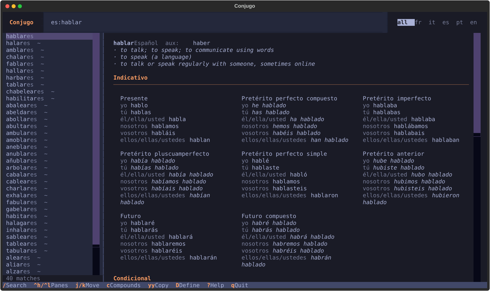
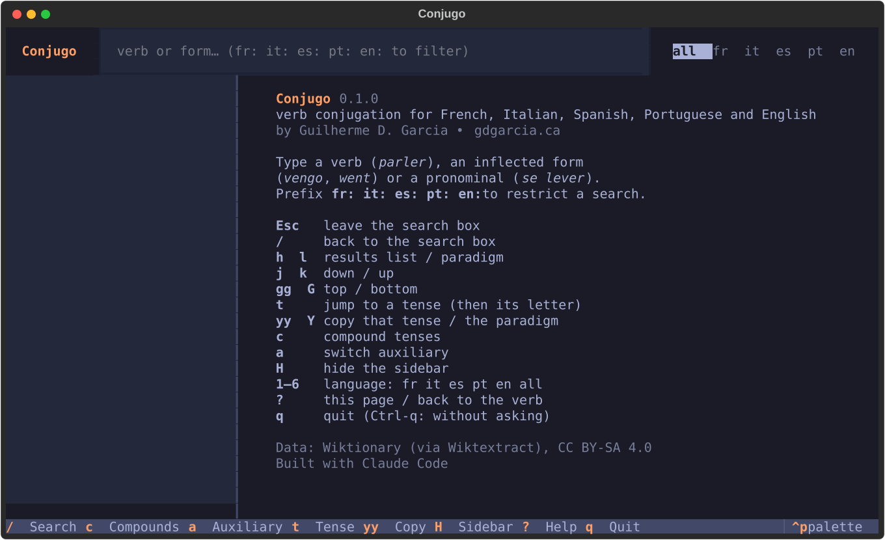
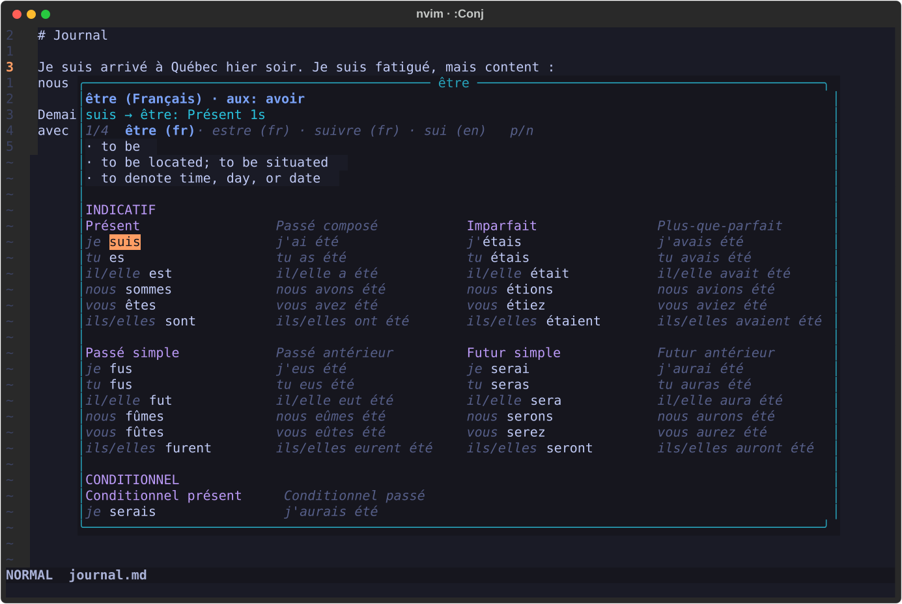

# Conjugo

Verb conjugation in the terminal for French, Italian, Spanish, Portuguese,
English and German, built on open Wiktionary data. It shows every simple and compound
tense, finds a verb from any of its forms, and runs from the `conj` command.

By **Guilherme D. Garcia**. Built with [Claude Code](https://claude.com/claude-code)
(see [How it was made](#how-it-was-made)).





```
conj                 # open the TUI
conj venir           # open the TUI on a verb
conj vengo           # inflected forms work too: vengo -> venire
conj -p fr aller     # print the paradigm to stdout (no TUI)
conj -p it correre -a avere   # choose the auxiliary for compound tenses
conj -p pt falar     # also es / pt
conj -p -s went      # simple tenses only
conj -j parlons      # JSON, exact matches only (used by the Neovim plugin)
```

## Features

- **Coverage:** about 7,500 French, 13,000 Italian, 8,900 Spanish, 6,400
  Portuguese, 57,000 English and 10,300 German verbs. You get every simple tense, plus
  compound tenses built from the right auxiliary with participle agreement
  (*je suis allé(e)*, *noi siamo andati/e*, *he hablado*, *tenho falado*).
  Spanish and Portuguese include the future subjunctive and the negative
  imperative; Portuguese adds the personal infinitive and the simple pluperfect.
- **German:** Perfekt and Plusquamperfekt with *haben* or *sein*, Futur I
  and II, Konjunktiv I and II with the *würde*-form, and separable verbs
  (*ich stehe auf*, *ich bin aufgestanden*). Verbs that take either
  auxiliary (*fahren*, *aufstehen*) start with *sein*; `a` switches.
  Reflexive verbs come from the base verb: type *sich freuen* for *ich freue
  mich*, *ich habe mich gefreut* (accusative pronouns; dative reflexives such
  as *sich etwas vorstellen* show *mich* too). Search finds
  subordinate-clause forms (*aufstehe*), and *ss* finds *ß*.
- **Pronominal verbs:** *se lever*, *s'en aller*, *alzarsi*, *andarsene*,
  *levantarse*, *levantar-se* and *sich freuen* all work. A French, Spanish or Portuguese
  pronominal that has no table of its own is generated from its base verb.
  Portuguese uses Brazilian clitic placement (*eu me levanto*, *eu tenho me
  levantado*, *levante-se*).
- **Dual auxiliaries:** verbs like *correre* or *monter* offer both
  auxiliaries. Press `a` to switch.
- **Reverse lookup:** type any form (*parlerions*, *fusse*, *went*) and the
  matching cell is highlighted.
- **Dictionary link:** on a Mac with [Lexis](https://github.com/guilhermegarcia/lexis)
  installed, `D` opens the verb's dictionary entries; quitting Lexis brings you
  back. Lexis's `C` does the reverse.
- **Search:** fuzzy and accent-insensitive (`allr` → *aller*, `parlo` →
  *parlò*). Prefix a query with `fr:`, `it:`, `es:`, `pt:`, `en:` or `de:` to restrict it.

### Keys

| Key | Action |
|---|---|
| type, `↓`, `Enter` | search, move to the results, open a verb |
| `Esc` | leave the search box (so `Esc` `q` quits) |
| `/` | back to the search box |
| `c` | show/hide compound tenses |
| `a` | switch auxiliary (dual-auxiliary verbs; shown in the footer only for those) |
| `Ctrl-h` / `Ctrl-l` | focus the results list / the paradigm (`h` / `l` work too) |
| `j` / `k`, `Ctrl-d` / `Ctrl-u` | down / up in the focused pane (results list or paradigm) |
| `gg` / `G` | first / last result, or top / bottom of the paradigm |
| `H` | hide/show the results sidebar |
| `t` + letter | jump to a tense (each tense shows its letter; `Esc` cancels) |
| `yy` | copy the selected tense, or the whole paradigm if none is selected |
| `Y` | copy the whole paradigm as plain text |
| `1`–`6`, `0` | language filter: fr / it / es / pt / en / de, `0` all (works while typing too) |
| `D` | define the verb in [Lexis](https://github.com/guilhermegarcia/lexis) (macOS; when it is installed) |
| `?` | home page with the key list; again to go back to the verb |
| `q` | quit (asks first: `y`/`q`/`Enter` quits, `n`/`Esc` stays); `Ctrl-q` quits at once |
| `Ctrl-p` | command palette, including a theme picker that previews each theme |

## Install

You need [uv](https://docs.astral.sh/uv/). Then:

```sh
uv tool install git+https://github.com/guilhermegarcia/conj
```

That puts `conj` on your PATH. The verb database (~30 MB) isn't in git: on its
first run `conj` downloads the release made for your version of the code,
checks its SHA-256, and unpacks it into `~/Library/Caches/conj` (or
`$XDG_CACHE_HOME/conj`, by default `~/.cache/conj` on Linux). Later runs work offline.

To update, run `uv tool upgrade conj` (or, from a clone, `git pull && uv tool
install --reinstall .`). If the new version needs a newer database, it
downloads it on its next run and deletes the old one. A copy at
`src/conj/data/conj.sqlite.gz` that isn't the release the code expects is
ignored.

To try it without installing: `uvx --from git+https://github.com/guilhermegarcia/conj conj`.

### Lexis (dictionaries, macOS)

[Lexis](https://github.com/guilhermegarcia/lexis) (`lexis`) shows the
dictionaries enabled in macOS Dictionary.app in the terminal, with the same
keys as Conjugo. Install both and they link up; nothing needs configuring:

```sh
uv tool install git+https://github.com/guilhermegarcia/lexis
```

- In Conjugo, `D` opens Lexis on the current verb, limited to dictionaries in
  the verb's language.
- In Lexis, `C` opens Conjugo on the verb under the cursor (or, from its
  dictionary list, on the headword), with the form highlighted: `C` on
  *parlerions* opens *parler*. If the word isn't a verb, Lexis says "Not a verb."
- The second app runs in the same terminal while the first waits. Quitting it
  (`q`) brings you back to where you were.
- `C` and `D` on the verb you came from go back instead of opening another
  app, so `D C D C` switches between the conjugation and the dictionary.

`D` appears only when Lexis is installed. Lexis needs macOS; Conjugo doesn't.

### Neovim

The repo is also a Neovim plugin (0.10 or later). `:Conj` opens a floating
window with the conjugation of the verb under the cursor, with the form under
the cursor highlighted. If the word isn't a verb, you get a message instead.
The plugin only draws the window: the conjugations come from `conj --json`, so
it needs Conjugo installed (see [Install](#install)), with `conj` on your PATH.
Without it, `:Conj` reports that it cannot run `conj`. If you have uv but would
rather not install Conjugo, the plugin can run it through `uvx` instead (it
downloads Conjugo on first use):

```lua
opts = { cmd = { "uvx", "--from", "git+https://github.com/guilhermegarcia/conj", "conj" } }
```



With lazy.nvim:

```lua
{
  "guilhermegarcia/conj",
  cmd = "Conj",
  keys = { { "\\Lc", "<cmd>Conj<cr>", desc = "conjugate" } },
  opts = { default_lang = "fr" }, -- optional: its verbs listed first
}
```

`\Lc` puts it in a `\L` ("language") menu next to spell checking and a
dictionary, the way the author uses it. With which-key, `\L` pops up the
three options:

| Keys | Action |
|---|---|
| `\Ls` + `e`/`f`/`i`/`p` | toggle spell checking in English/French/Italian/Portuguese |
| `\Ld` + `e`/`f`/`i`/`p`/`g`/`s` | define the word under the cursor (…/German/Spanish) |
| `\Lc` | conjugate the word under the cursor (this plugin) |

Only `\Lc` comes with Conjugo; the other two are ordinary mappings in your own
config. A sketch, with a `def` dictionary command standing in for yours:

```lua
local names = { en = "English", fr = "French", it = "Italian", pt = "Portuguese",
                de = "German", es = "Spanish" }
require("which-key").add({
  { "\\L", group = "language" },
  { "\\Ls", group = "spellcheck" },
  { "\\Ld", group = "define" },
})
for key, lang in pairs({ e = "en", f = "fr", i = "it", p = "pt" }) do
  vim.keymap.set("n", "\\Ls" .. key, function()
    local on = vim.wo.spell and vim.bo.spelllang == lang
    vim.opt_local.spell = not on
    vim.opt_local.spelllang = { lang }
  end, { desc = names[lang] .. " spellcheck" })
end
for key, lang in pairs({ e = "en", f = "fr", i = "it", p = "pt", g = "de", s = "es" }) do
  vim.keymap.set("n", "\\Ld" .. key, function()
    vim.cmd("!def -l " .. lang .. " " .. vim.fn.shellescape(vim.fn.expand("<cword>")))
  end, { desc = "Define " .. names[lang] })
end
```

Spell checking and conjugation work together: when spell checking is on in
one language (`\Lsp`), `\Lc` lists that language's verbs first.

`:Conj fr` (or it/es/pt/en/de, or `b:conj_lang`) searches only that language.
Otherwise every language is searched, and a guessed language's verbs come
first: the spell-check language (when `'spell'` is on with a single
`'spelllang'`), else `default_lang` (`opts = { default_lang = "fr" }`).

When several verbs have the form (*suis*: *être*, *suivre*; *fui*: *fuir*,
*ser*, *ir*), the header lists them and `p`/`n` switch between them. In the
window, `q` or `Esc` closes it. Options, highlight groups: `:help conjugo`.

### Building the database yourself

From a clone, `uv run conj-build` builds `src/conj/data/conj.sqlite.gz` from
Wiktionary. It downloads about 250 MB of gzip-compressed Wiktextract dumps
(2.4 GB unpacked), caches them in `~/.cache/conj-build` (`--refresh` fetches
fresh copies), and builds the database in about 30 s. `conj` uses a local build
only once `DATA_TAG`/`DATA_SHA256` in `db.py` match it (`conj-build` prints the
checksum); until then, point `conj` at it with `CONJ_DB=/path/to/conj.sqlite`.

## Development

```sh
uv run pytest              # golden tests against the built database
```

The code is organized as follows:

| Module | Role |
|---|---|
| `build.py` | Wiktextract JSONL → SQLite (tag mapping in `tags.py`, spelling in `normalize.py`) |
| `langs/` | per-language labels, pronouns, sections, compound tenses |
| `compound.py` | compound and periphrastic tenses, agreement, clitics |
| `pronominal.py` | FR/ES/PT pronominals generated from the base verb |
| `search.py` | lookup: lemma, inflected form, fuzzy |
| `tui/` | Textual app |

To add a language, write `langs/xx.py` and add a source to `build.SOURCES`.
Any language with Wiktionary conjugation tables (German, Catalan…) can be
added this way.

## How it was made

Conjugo was built with [Claude Code](https://claude.com/claude-code),
Anthropic's coding agent. Guilherme D. Garcia designed the app and directed
the work: the languages and the open data sources, the linguistic decisions
(which tenses to show and how to label them, Brazilian clitic placement for
Portuguese), the interface and its keys, and the review of the output. Claude
Code wrote most of the code, the tests and the documentation, and investigated
the Wiktionary data. Commits made with it carry a `Co-Authored-By: Claude`
line.

## Credits

- Verb tables, auxiliaries and glosses: [Wiktionary](https://en.wiktionary.org)
  contributors, extracted by [Wiktextract](https://kaikki.org)
  (Tatu Ylonen, LREC 2022).
- Frequency ranking: [wordfreq](https://github.com/rspeer/wordfreq), by Robyn Speer.
- Interface: [Textual](https://textual.textualize.io); fuzzy search:
  [RapidFuzz](https://github.com/rapidfuzz/RapidFuzz).

## License

The code is MIT (`LICENSE`), © 2026 Guilherme D. Garcia. The verb data is
CC BY-SA 4.0, from Wiktionary contributors via Wiktextract (`DATA_LICENSE.md`).
